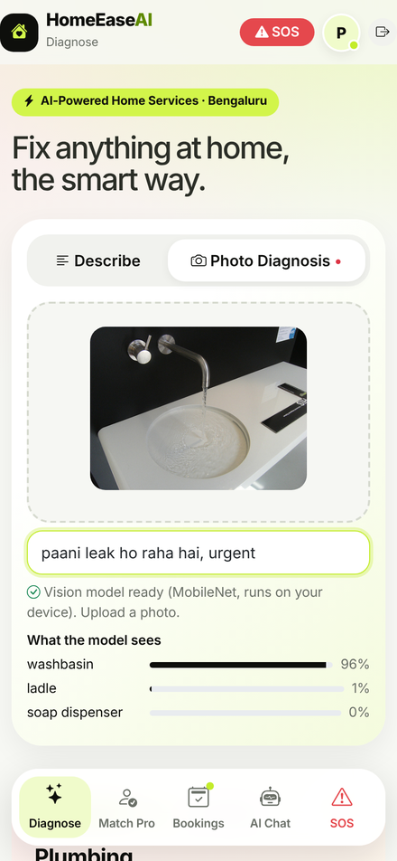
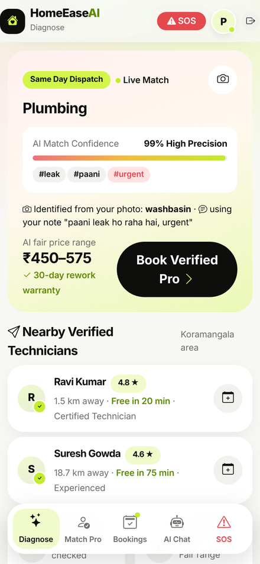
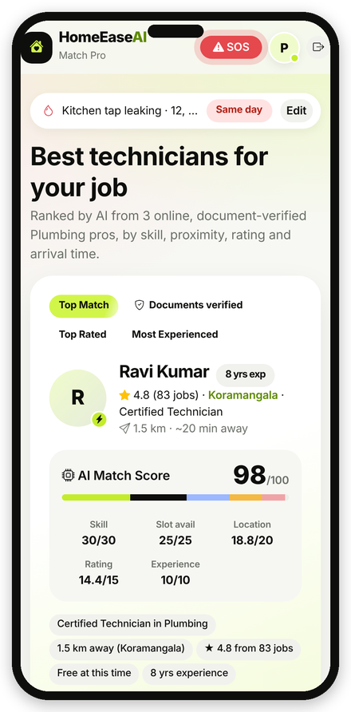
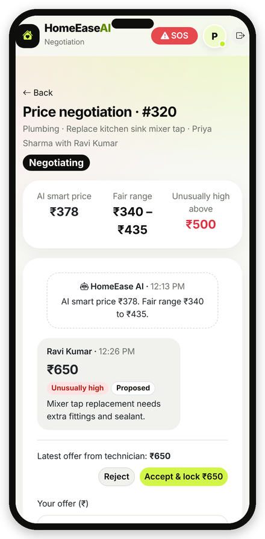
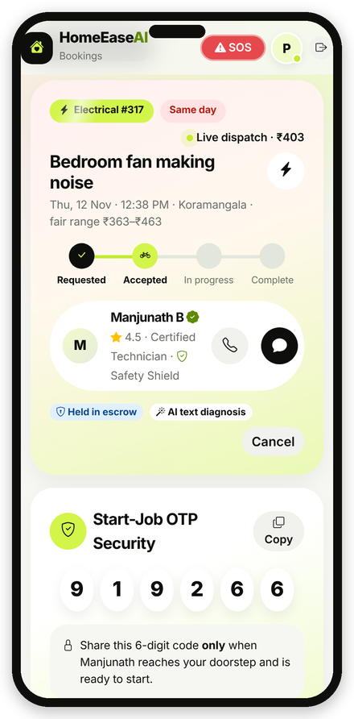
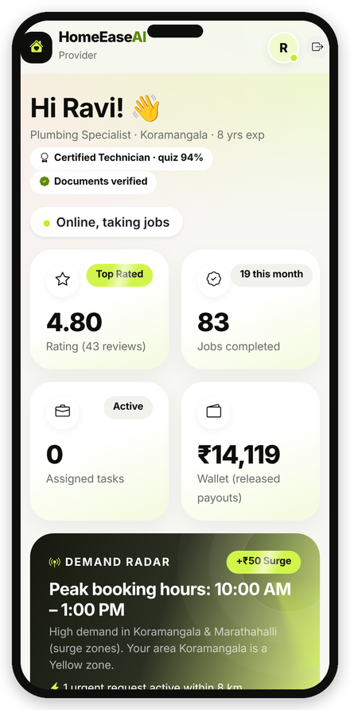
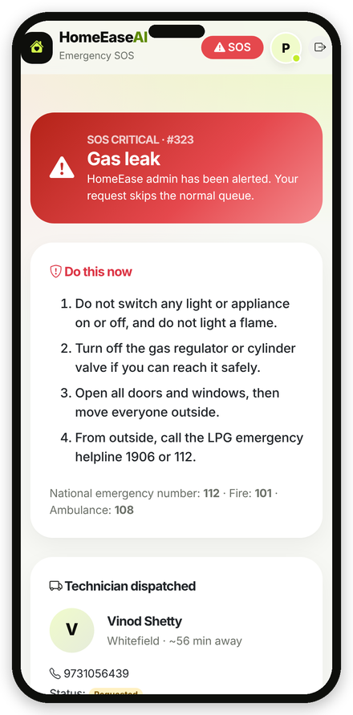
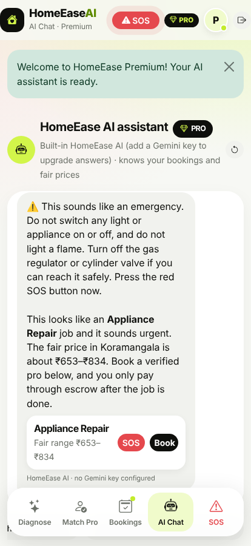
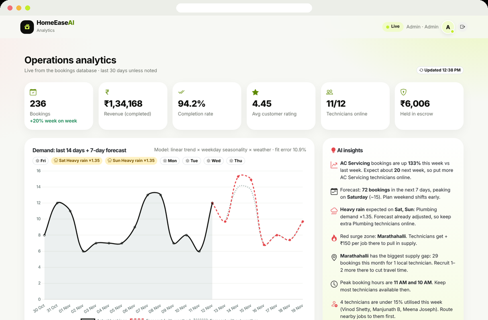

<div align="center">

# 🏠 HomeEase AI

### Intelligent Home Services Booking & Management Platform

Describe the problem or snap a photo. AI picks the service, shows a fair price, matches the best verified technician,<br>
holds payment in escrow and keeps everyone safe with SOS + Safety Shield.

**Tech-Bees Computer Vision Hackathon 2026 · Presidency University, Bengaluru**


</div>

---

## 📸 Screenshots

| Photo diagnosis | AI result | Smart match | Fair-price negotiation |
|:---:|:---:|:---:|:---:|
|  |  |  |  |
| **Bookings · escrow · OTP** | **Technician app** | **Emergency SOS** | **Premium AI chat (Gemini)** |
|  |  |  |  |

**Admin dashboard: weather-aware demand forecast, live SOS monitor, surge zones**



---

## ✨ Features

| | Feature | What it does |
|---|---|---|
| 📷 | **Photo diagnosis (computer vision)** | MobileNet runs **in the browser, offline**. Snap a sink, fan or fridge and it picks the service. Add a note like "sparking, urgent" and the result updates live. Our own Teachable Machine model loads first if present. |
| 💬 | **AI problem assistant** | NLP classifier for **English + Hinglish** ("nal tapak raha hai"). Detects service, urgency and hazards (gas, sparks, flooding). |
| 💰 | **Smart fair price** | Price from base, urgency, peak hours, demand and surge zone, shown as a fair range **before** booking. |
| ⚖️ | **Fair-price guardrail** | Technician quotes are flagged *Within range / Fair / Unusually high*, with a suggested counter-offer. |
| 🎯 | **100-point technician matching** | Explainable score: skill, availability, distance, rating, experience. Emergencies weight distance higher. |
| 🔒 | **Escrow + OTP + warranty** | Pay into escrow, technician starts with a 6-digit OTP, money released on confirmation, 30-day digital warranty. |
| 🆘 | **Emergency SOS + Safety Shield** | Safety steps, nearest qualified technician, hospital info; technician safety tracked outbound → on job → return. |
| 🔁 | **Auto-replacement** | Decline, cancel or no response in 10 min, and the next best technician is assigned with the price kept. |
| 📈 | **Demand forecast** | Trend × weekday seasonality × weather (rain → plumbing, heat → AC), with MAPE. |
| 🗺️ | **Surge zones** | Busy areas pay technicians extra (+₹50 / +₹150). |
| 💎 | **Premium + Gemini chatbot** | Premium customers chat with HomeEase AI (Google Gemini). Built-in fallback if the API is unavailable. |
| ⚡ | **Live updates** | Customer, technician and admin screens refresh by themselves when something changes. No refresh button. |

## 🧠 How the AI works

| Feature | Logic | Code |
|---|---|---|
| Problem classifier | Keyword scoring, English + Hinglish, hazard regex | `classify_problem()` |
| Photo diagnosis | MobileNet v1 (ImageNet, 1000 classes) → service map; caption adds urgency + hazards | `assets/js/assistant.js` |
| Smart price | `P = base × (1 + urgency + peak + demand) + zone bonus + ₹29`, range `0.90P – 1.15P` | `estimate_price()` |
| Fairness | ≤ Pmax within · ≤ 1.15 Pmax fair · above = unusually high | `fairness()` |
| Matching | Skill 24 · Availability 25 · Location 20 · Rating 15 · Experience 10 (+ tier bonus) | `match_technicians()` |
| Forecast | OLS trend × weekday seasonality × weather multiplier | `forecast_demand()` |
| Replacement | Next best technician, escrow kept, logged | `replace_technician()`, `sos_watchdog()` |

**Booking lifecycle:** negotiating → pending → accepted → in progress → completed / cancelled<br>
**Escrow:** unpaid → held → released / refunded / disputed

---

## 🚀 Run it locally (XAMPP, 5 minutes)

1. Clone or download into your XAMPP `htdocs`:
   ```bash
   cd C:\xampp\htdocs
   git clone https://github.com/MdZeeAnsari/homeease-ai.git homeease
   ```
2. Start **Apache** and **MySQL** in the XAMPP Control Panel.
3. Open **http://localhost/homeease/setup.php**. This creates the database, tables and demo data.
   *If MySQL root has a password, the app reads it from XAMPP's phpMyAdmin config automatically; otherwise set it in `config/db.php`.*
4. Open **http://localhost/homeease/**

**Phones on the same Wi-Fi:** `http://<laptop-IP>/homeease/` (find the IP with `ipconfig`).

**Optional: Gemini chatbot.** Put your key from [Google AI Studio](https://aistudio.google.com/apikey) in `config/ai.php`.
Never commit a real key.

### Demo logins
| Role | Email | Password |
|---|---|---|
| Customer | priya@homeease.in | demo123 |
| Premium customer | aditya@homeease.in | demo123 |
| Technician | ravi@homeease.in | demo123 |
| Admin | admin@homeease.in | admin123 |

---

## 🛠️ Tech stack

- **Backend:** PHP 8 (no framework), MySQL / MariaDB via `mysqli` prepared statements
- **Frontend:** Bootstrap 5, Bootstrap Icons, Chart.js, custom motion layer
- **AI / ML:** TensorFlow.js + MobileNet (bundled, works offline), Teachable Machine support, NLP classifier, Google Gemini API
- **Security:** CSRF tokens, `password_hash`, HttpOnly + SameSite cookies, login throttling, atomic escrow updates, server-side API key

```
homeease/
├── index.php, book.php, match.php, negotiate.php, my_bookings.php, sos.php, chat.php   # customer
├── provider.php                                                                          # technician
├── admin.php, admin_bookings.php                                                         # admin
├── api/            assistant, estimate, pulse (live refresh), chat (Gemini)
├── includes/       functions.php (all AI logic), header/footer
├── config/         db.php, ai.php
└── assets/         css, js, vendor (Bootstrap, Chart.js, TF.js, MobileNet), model/ (Teachable Machine)
```

---

## 👥 Team

| Name | Roll No. |
|---|---|
| Mohammed Ayman | 20241CSE0129 |
| Mohammed Zeeshan Ansari | 20241CSE0262 |
| Shivang S Dayal | 20241CSE0058 |
| Mohammed Abid Ali | 20241CSE1118 |

B.Tech Computer Science & Engineering · Presidency University, Bengaluru
